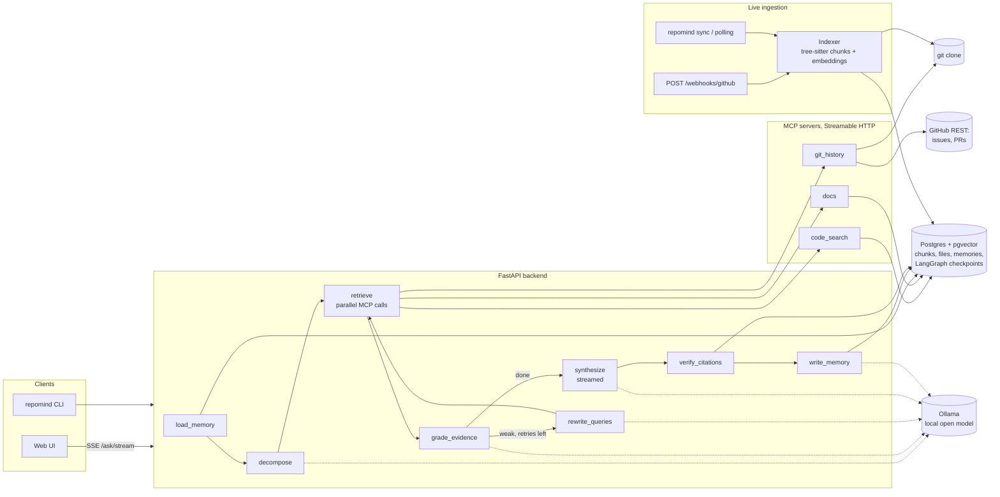

# RepoMind (BadeBhai)

RepoMind answers questions about a GitHub repository by combining its **code, commit history,
issues/PRs and docs**. Every claim carries a citation that is checked programmatically, the index
stays **live** as the repo changes, and the assistant **remembers** durable facts about each user.

It is **completely free and self-hosted**: a local open model through Ollama, local embeddings,
Postgres, and open-source everything else. No API keys, no paid services, and your code never
leaves your machine.

It is an agentic RAG system: a LangGraph agent decomposes the question, calls data sources that are
separate **MCP servers**, grades its own evidence (re-planning weak searches), and writes a cited
answer, or says "insufficient evidence" when the repository does not support one.

Real output from the default local model (`qwen3:4b-instruct` on a laptop RTX 3050 with 4 GB VRAM):

```text
You:      Why was the retry logic added, and is it related to any open issues?
RepoMind: The retry logic was added to enable automatic retries for failed HTTP connections, using
          urllib3's `Retry` class, to improve resilience in network requests by handling transient
          failures such as timeouts, DNS lookups, and server errors [1][2]. This functionality is
          implemented in the `HTTPAdapter` class, where `max_retries` allows configuration of retry
          behavior for connection-level failures [1].
          While there is no open issue specifically about retry functionality in the requests library,
          issue #6512 discusses a related problem: requests are not retried when a response body is
          shorter than its `Content-Length` [3]. ...
          [1] src/requests/adapters.py#L167-L200  [2] docs/user/advanced.rst#L1035-L1061
          [3] issue #6512  [4] issue #4747  [5] issue #5975          (5/5 citations verified, $0)
```

## Contents
[Quick start](#quick-start) · [Completely free](#completely-free) · [Architecture](#architecture) ·
[Using it](#using-it) · [How it works](#how-it-works) · [Evaluation](#evaluation) ·
[Configuration](#configuration) · [Development](#development) ·
[Limitations and next steps](#limitations-and-next-steps)

## Quick start

**Docker (one command, no keys needed):**

```bash
docker compose up --build                                             # CPU
docker compose -f docker-compose.yml -f docker-compose.gpu.yml up --build   # NVIDIA GPU: much faster
```

Open **http://localhost:8000**. First start downloads the local model (`qwen3:4b-instruct`, 2.5 GB)
and clones and indexes the demo repo (`psf/requests` pinned at `v2.32.3`, about a minute). To index
another repo, set `AUTO_INGEST_REPO=owner/name` or `POST /repos {"source": "owner/name"}`.
Optionally copy `.env.example` to `.env` and add a free `GITHUB_TOKEN` (raises GitHub's limit from
60 to 5,000 requests/hour).

**Local (Python 3.11+):**

```bash
python -m pip install uv && uv sync
docker compose up -d db ollama ollama-pull    # Postgres+pgvector on :5433, Ollama on :11434 (+ model)
uv run repomind ingest psf/requests@v2.32.3   # clone + index (any public repo or local path works)
uv run repomind serve                         # http://localhost:8000, also starts the 3 MCP servers
```

A native Ollama install (ollama.com) works too: `ollama pull qwen3:4b-instruct` and keep
`OLLAMA_BASE_URL=http://localhost:11434`.

## Completely free

| Part | What runs | Cost |
|---|---|---|
| LLM | Ollama + open-weight model (`qwen3:4b-instruct` by default), on your CPU/GPU | $0 |
| Embeddings | `BAAI/bge-small-en-v1.5` via sentence-transformers, CPU | $0 |
| Storage, search, memory, checkpoints | Postgres 16 + pgvector | $0 |
| Agent, API, MCP servers, UI | LangGraph, FastAPI, official MCP SDK, vanilla JS | $0 |
| Code parsing | tree-sitter | $0 |
| Issues / PRs | GitHub REST API (60 req/h anonymous, 5,000 with a free token) | $0 |
| Tracing | structured JSON logs + the trace shown in the UI (LangSmith optional) | $0 |

Everything is open source and runs on your machine. (Docker Desktop is free for personal use, education
and small businesses; Docker Engine on Linux and Podman are free for everyone.)

**Picking a model.** The model is one setting (`OLLAMA_MODEL`). Measured on a laptop RTX 3050 with
4 GB VRAM, `qwen3:4b-instruct` (81% on GPU) answers naive questions in about 17 s and agent questions
in about 45 s (median over the 38-question eval). `qwen2.5:3b` fits fully on that GPU and is 3x faster, but in testing it graded
every evidence item 0.0, so it is not recommended. With 8 GB+ VRAM, a 7-14B instruct model is a
better choice; with no GPU everything still works, just slower. Use an *instruct* (non-thinking)
model: reasoning models spend minutes thinking on every step. Paid Claude remains available as an
optional extra (`uv sync --extra anthropic`, `LLM_PROVIDER=anthropic`).

Try: *Where is authentication handled?* · *Why was the retry logic added, and is it related to any
open issues?* · *What changed in src/requests between 2024-05-01 and 2024-05-31?* · *Which files would
I touch to add a new top-level helper like requests.get?*

## Architecture



| Piece | Choice |
|---|---|
| Agent | LangGraph; state checkpointed per thread in Postgres (`AsyncPostgresSaver`) |
| LLM | local open model via Ollama (default `qwen3:4b-instruct`) behind a small `LLMProvider` interface; JSON-schema constrained output for planning, grading and memory; streamed synthesis. Claude is an optional provider |
| Data sources | three MCP servers built with the official MCP Python SDK; the agent is an MCP client and discovers tools with `list_tools` |
| Storage | one Postgres: pgvector HNSW + `tsvector` full-text (hybrid search with reciprocal rank fusion), files and hashes, memories, checkpoints |
| Chunking | tree-sitter function/class chunks (Python, JS, TS/TSX, Go, Java, Rust), heading-based Markdown/RST sections, sliding windows otherwise |
| Embeddings | local `BAAI/bge-small-en-v1.5` (sentence-transformers, CPU), configurable |

## Using it

**Web UI** (`/`): ask questions, watch the agent's steps stream in (sub-questions, MCP tool calls,
grading, verification), click `[n]` chips to open the cited code, commit or issue, and see or delete
what RepoMind remembers about you.

**API**

| Endpoint | Purpose |
|---|---|
| `POST /ask` | `{"question", "repo", "mode": "agent"\|"naive", "user_id", "thread_id"}` returns the answer, citations, verification report, trace, sub-questions, tool calls, usage |
| `POST /ask/stream` | the same as server-sent events: `start`, `step`, `tool`, `token`, `final`, `error` |
| `GET /memories?user_id=&repo=` · `DELETE /memories/{id}?user_id=` · `DELETE /memories?user_id=` | user control over long-term memory |
| `POST /repos` · `GET /repos` · `POST /repos/{owner}/{name}/sync` · `GET /jobs/{id}` | ingest, list, sync |
| `POST /webhooks/github` | GitHub push webhook (HMAC-SHA256 verified) |
| `GET /search?repo=&q=&kind=code\|doc\|all` · `GET /tools` | debugging: raw hybrid search, discovered MCP tools |

**CLI**: `repomind ingest | sync [--watch] | repos | search | ask | serve | mcp up | mcp serve |
memories list|delete|clear | eval | reset-db`.

**MCP servers** can also be used on their own from any MCP-compatible client:
`uv run repomind mcp serve git_history --transport stdio`.

| Server | Port | Tools |
|---|---|---|
| `code_search` | 8101 | `search_code`, `read_code`, `file_outline`, `list_files` |
| `git_history` | 8102 | `search_commits`, `get_commit`, `blame`, `file_history`, `recent_changes`, `search_issues`, `get_issue`, `prs_for_commit` |
| `docs` | 8103 | `search_docs`, `read_doc`, `list_docs` |

## How it works

**The agent.** `decompose` splits the question into up to 5 sub-questions, each with the sources it
needs (code, docs, commits, issues) and first tool calls planned from the MCP tool catalog. `retrieve`
runs all planned calls in parallel. `grade_evidence` scores each evidence item's relevance to its
sub-question and decides whether the evidence is sufficient. Weak sub-questions go to
`rewrite_queries`, which plans new calls from what was found (for example `blame` on a code range it
found, then `get_commit` / `prs_for_commit`), never repeating a call, at most `MAX_RETRIES=2` times;
after that the sub-question is marked **insufficient**. `synthesize` writes the answer from graded
evidence only (if nothing passed grading, the answer is a fixed "Insufficient evidence" message, so
there is no path to a guessed answer). `write_memory` updates long-term memory.

**Citations.** The model writes `[n]` markers that refer to numbered evidence; it never writes the
citation targets itself. `verify_citations` then checks every marker: the evidence id exists, the
file is indexed, the line range exists, and the cited lines still match the file (catching stale or
fabricated ranges); commits must exist in the clone. Invalid markers are stripped, claims left
unsupported are flagged `⚠️(unverified)`, inline `path:line` references are checked too, and
surviving citations are renumbered.

**Live data.** Each file's sha256 and each repo's last indexed commit are stored. A signed push
webhook, `repomind sync`, or polling diffs from the last indexed commit and re-chunks and re-embeds
only changed files, deleting chunks of removed files; a per-repo advisory lock serializes runs.
Issues, PRs and commits are not bulk-indexed: `git_history` reads commits, blame and diffs from the
local clone and issues/PRs live from GitHub (short TTL cache, retries with backoff, a clear message
on rate limits). Ingestion respects `.gitignore`, skips binaries, vendored and huge files, and redacts
secrets (keys, tokens, PEM blocks) without changing line numbers.

**Memory.** Short-term: the thread's recent turns live in the LangGraph checkpointer (thread ids are
namespaced per user). Long-term: a `memories` table per user and repo. An extractor proposes facts from
the user's own messages only (never from repository text), and a write policy keeps only durable,
user-specific facts (role, focus area, preferences, repeated corrections, project context) with
importance at or above `MEMORY_IMPORTANCE_THRESHOLD`; it rejects code, questions, secrets and
instruction-like text. A contradicting fact supersedes the old one, a duplicate refreshes it, and
retrieval weight decays with a 30-day half-life when a memory is not used. The extractor is only
called when the user says something about themselves, which saves an LLM call on most questions.

**Safety.** The agent is read-only: it never writes to the repo or runs its code; git arguments are
validated (no option injection) and paths are confined to the repo. All repository text is
untrusted: it is placed only inside evidence blocks delimited by a fresh random tag per request,
delimiter look-alikes are neutralized, instruction-like text is flagged, and every prompt tells the
model to ignore instructions inside evidence (tested end to end, plus an opt-in live test). Tool
calls, retries and request time are capped per question.

## Evaluation

**Golden set:** 38 questions on `psf/requests` pinned at `v2.32.3`
([golden YAML](repomind/evals/golden/requests_v2_32_3.yaml)): 14 location, 5 how-it-works,
7 history/why, 2 live-issue, 4 change-planning, 3 docs and 3 unanswerable. Each has expected files or
commit shas and a reference answer checked against the snapshot (source, git history, HISTORY.md).

**Metrics:** retrieval hit@k (an expected file, commit or issue among the top-k evidence items),
citation validity (verified / total), whether the answer cites an expected source, LLM-judge
correctness (0-1 against the reference), "insufficient evidence" accuracy on unanswerable questions,
over-abstention, latency p50/p95, cost and LLM / tool calls per question.

```bash
uv run repomind eval --retrieval-only     # no LLM calls: hit@k of the naive retrieval
uv run repomind eval --limit 5            # both systems + judge on 5 questions (local model, free)
uv run repomind eval                      # full run; writes repomind/evals/reports/latest.md
uv run repomind eval --resume <run_id>    # continue an interrupted run (results are checkpointed)
```

### Results

Full run, all 38 questions, everything local and free: `qwen3:4b-instruct` via Ollama (also the
judge) on a laptop RTX 3050 with 4 GB VRAM
([report](repomind/evals/reports/20261125-114631.md)):

| Metric | Naive RAG (1 hybrid search + 1 LLM call) | Agentic pipeline |
|---|---|---|
| Retrieval hit@1 | 71.4% | **91.4%** |
| Retrieval hit@3 | 91.4% | **97.1%** |
| Retrieval hit@5 / hit@10 | 91.4% | **100%** |
| Answer cites an expected file, commit or issue | 88.6% | **100%** |
| Citation validity (verified / total) | 98.6% | 98.8% |
| LLM-judge correctness, 0-1 (abstaining on an answerable question = 0) | 0.74 | **0.79** |
| Says "insufficient evidence" on unanswerable questions | 3/3* | 3/3 |
| Abstains on answerable questions | 0% | 0% |
| Latency p50 | 16.8 s | 43.5 s |
| LLM calls / MCP tool calls per question | 1 / 0 | 3.8 / 5.9 |
| Cost | $0 | $0 |

Judge correctness by category (naive → agent): issues 0.88 → 1.00, planning 0.69 → 0.94, how-it-works
0.60 → 0.85, location 0.80 → 0.84, docs 1.00 → 1.00, unanswerable 1.00 → 1.00, history 0.50 → 0.32.

How to read it:
- **The agent finds the right evidence far more often** (hit@1 91% vs 71%; the expected source is in
  its evidence for every answerable question). Naive hit@k tops out at 91.4% because 3 questions can
  only be answered from commits or live issues, which a code/doc index cannot return.
- **The answer-quality gap is smaller than the retrieval gap.** The judge is the same 4B model, and
  it is noisy: it gave "incorrect" to an agent answer that named the exact expected commit. History
  ("why"/"when") questions are still the weak spot: the model reasons poorly over commit lists.
- **Latency p95 is not reported** because it measured the build machine, not the agent: Docker
  Desktop's WSL2 GPU passthrough stalled several times during the run (the GPU sat idle while requests
  hung), and the 5 agent answers over 2 minutes all fell in those windows. Without stalls agent
  answers take about 30-110 s.
- \*The abstention detector missed one correct naive refusal ("Requests does not manage WebSocket
  connections") and reported 66.7%; the detector now recognises that phrasing.

**What the eval changed.** The first full run ([before](repomind/evals/reports/20261125-090834-before-fixes.md))
had the agent *behind* naive on retrieval (hit@1 69.7%) and abstaining on 15% of answerable
questions, with a judge score of 0.72. Traces of those failures led to five fixes, all deterministic
code around the model rather than prompt tweaks: an empty sub-question block in the grader prompt
made the 4B model answer "no items provided" and score everything 0; the planner paraphrased away
decisive words ("case-insensitively"), so the first round now also searches with the sub-question
verbatim; near-duplicate sub-questions are merged; date windows the model invented are dropped
unless the user named one; and shortened evidence now shows the part that matches the question. The
eval also stopped counting the judge's 1.0 for an "insufficient evidence" reply to an answerable
question.

Earlier retrieval-only work:
- hit@1 went from 42.9% to 71.4% after two changes the eval motivated: presenting code and doc hits
  interleaved instead of sorted by score (docs used to bury code on "where is X" questions), and
  grouping runs of tiny definitions such as the 25 small exception classes into one chunk
  ([before](repomind/evals/reports/20261124-230021-before-interleave.md),
  [after](repomind/evals/reports/20261124-230610.md)).

## Configuration

All settings come from environment variables or `.env` ([.env.example](.env.example)). The main ones:

| Variable | Default | Meaning |
|---|---|---|
| `LLM_PROVIDER` | `ollama` | `ollama` (free, local), `anthropic` (optional extra, paid) |
| `OLLAMA_MODEL` / `OLLAMA_FAST_MODEL` | `qwen3:4b-instruct` / same | main model; optional model for decompose/grade/rewrite/memory (keep empty on small GPUs: swapping models is slow) |
| `OLLAMA_BASE_URL` | `http://localhost:11434` | compose sets `http://ollama:11434` |
| `OLLAMA_NUM_CTX` | `8192` | context window; evidence budgets scale with it (raise it if your GPU has room) |
| `OLLAMA_THINK` | `false` | reasoning mode of thinking models (slower) |
| `GITHUB_TOKEN` | (none) | free token; raises GitHub limits from 60 to 5,000 requests/hour |
| `GITHUB_WEBHOOK_SECRET` | (none) | enables `POST /webhooks/github` |
| `EMBEDDING_MODEL` / `EMBEDDING_DIM` | `BAAI/bge-small-en-v1.5` / `384` | changing the model triggers a full re-embed |
| `MCP_TRANSPORT` | `http` | `http`, `stdio` or `inmemory` |
| `MAX_TOOL_CALLS` / `MAX_RETRIES` / `MAX_SUBQUESTIONS` | `24` / `1` / `3` with Ollama (`2` / `5` otherwise) | per-question guardrails; the local profile also uses smaller evidence quotas and a 20-minute request timeout |
| `GRADE_THRESHOLD` | `0.5` | minimum graded relevance for evidence to be used |
| `MEMORY_IMPORTANCE_THRESHOLD` / `MEMORY_HALF_LIFE_DAYS` | `0.6` / `30` | memory write policy and decay |
| `SYNC_POLL_INTERVAL_S` | `0` | poll for new commits every N seconds (0 = off) |
| `AUTO_INGEST_REPO` | (none; compose sets `psf/requests@v2.32.3`) | ingest on startup if missing |
| `LANGSMITH_TRACING` / `LANGSMITH_API_KEY` | `false` / (none) | LangSmith traces of every graph node and LLM call; otherwise JSON logs |

Prompts are versioned files in [repomind/app/prompts](repomind/app/prompts) (`name.vN.md`); pin one
with `PROMPT_VERSION_<NAME>=N`.

## Development

```bash
docker compose up -d db
uv run pytest                        # 108 tests; DB tests use a separate `repomind_test` database
uv run ruff check . && uv run ruff format --check .
RUN_LIVE=1 uv run pytest -m live     # 2 tests against the real local model (free; needs Ollama running)
```

Tests use a deterministic hashing embedder and a scripted fake LLM, so they need no downloads or keys.
They cover chunking, redaction, hybrid retrieval, incremental sync, the three MCP servers (with a
mocked GitHub), the citation verifier, the memory policy, the full `/ask` and `/ask/stream` flows,
grading and retries, insufficient evidence, prompt-injection containment, webhooks, and the eval runner.

Recording a demo: see [docs/demo-script.md](docs/demo-script.md) (browser walkthrough) and
[docs/demo.tape](docs/demo.tape) (terminal GIF with VHS).

```
repomind/
  app/          api, agent graph + nodes, prompts, memory, citations, MCP client, naive baseline
  mcp_servers/  code_search, git_history, docs (+ GitHub client)
  ingestion/    chunker, filters, secret redaction, indexer, webhook, sync
  retrieval/    hybrid search
  llm/          provider interface, Ollama (default) and optional Claude implementations, fake
  evals/        golden set, runner, metrics, judge, reports
  ui/           web UI served at /
tests/          unit + integration
```

## Limitations and next steps

**Limitations**
- **A small local model is slower and less capable than a frontier model.** On a 4 GB laptop GPU an
  agent answer takes about 45 s, and the 4B model sometimes plans weak queries, grades too strictly
  or reasons poorly over commit history; deterministic plan repair, verbatim baseline searches and
  the "partial" status compensate, but history answers are still the weakest category. More VRAM
  and a larger instruct model help the most.
- **GPU passthrough on Docker Desktop (Windows/WSL2) can stall.** During long runs on the build
  machine, Ollama occasionally hung with the GPU idle (once with a CUDA error). The provider retries
  server errors, evals checkpoint and `--resume`, and `docker compose restart ollama` clears it; a
  native Ollama install on Windows avoids the WSL2 layer.
- The LLM judge in the eval is the same small local model, so correctness scores are a noisy signal;
  `repomind eval --judge-model <larger model>` uses a stronger judge if you have one.
- **No authentication.** `user_id` is supplied by the client, so anyone who knows a user id can read
  or delete that user's memories. Fine for a local demo, not for a shared deployment.
- The verifier proves that cited evidence is real and unchanged; it does not prove that the claim
  follows from the cited text (entailment).
- Issues and PRs come from GitHub's keyword search API (10 searches/minute unauthenticated), not
  semantic search; issue questions are non-deterministic in the eval because the data is live.
- tree-sitter chunking covers six languages; others use sliding windows. Wiki indexing is
  best-effort (public GitHub wikis only).
- All repos share one HNSW index, which relies on pgvector's iterative scan for filtered queries;
  very large monorepos would want per-repo partitioning, and history tools need a full clone.
- On Windows the API must use the HTTP MCP transport (async psycopg needs a selector event loop,
  which cannot spawn stdio subprocesses); Docker and Linux/macOS are unaffected.

**Next steps**
1. Compare local models on the golden set (a 7-8B instruct model on a GPU with more VRAM is the
   obvious next point), and tune `GRADE_THRESHOLD` and prompts per question category.
2. Add a local cross-encoder reranker after hybrid search (for example a small bge reranker; also
   free), and an entailment check to the verifier.
3. Put the API behind auth (OIDC) and derive `user_id` from the token; per-repo webhook secrets or a
   GitHub App.
4. Cache issue/PR embeddings for semantic search over discussions, including PR review comments.
5. Partition chunks per repo and support shallow clones with on-demand history.
