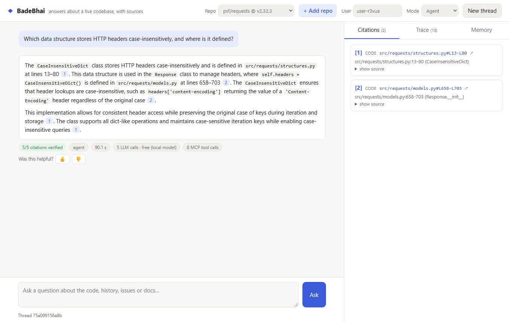

# BadeBhai

BadeBhai answers questions about a GitHub repository by combining its **code, commit history,
issues/PRs and docs**. Every claim carries a citation that is checked programmatically, the index
stays **live** as the repo changes, and the assistant **remembers** durable facts about each user.

It is **completely free and self-hosted**: a local open model through Ollama, local embeddings,
Postgres, and open-source everything else. No API keys, no paid services, and your code never
leaves your machine.

It is an agentic RAG system: a LangGraph agent decomposes the question, calls data sources that are
separate **MCP servers**, grades its own evidence (re-planning weak searches), and writes a cited
answer, or says "insufficient evidence" when the repository does not support one.

**Try it:** [live demo](https://badebhai.onrender.com/ui/), with two ready-to-ask repositories
(`psf/requests` and `sindresorhus/ky`) and every feature: cited answers, the code viewer, the codebase
map, commit history and repo comparison. It runs on free hosting, so after a quiet spell the first
visit takes about a minute to wake up. To add and remove your own repositories, including private
ones, [run it on your machine](#quick-start) (free, three commands).



Real output from the default local model (`qwen3:4b-instruct` on a laptop RTX 3050 with 4 GB VRAM):

```text
You:      Why was the retry logic added, and is it related to any open issues?
BadeBhai: The retry logic was added to enable automatic retries for failed HTTP connections, using
          urllib3's `Retry` class, to improve resilience in network requests by handling transient
          failures such as timeouts, DNS lookups, and server errors [1][2]. This functionality is
          implemented in the `HTTPAdapter` class, where `max_retries` allows configuration of retry
          behavior for connection-level failures [1].
          While there is no open issue specifically about retry functionality in the requests library,
          issue #6512 discusses a related problem: requests are not retried when a response body is
          shorter than its `Content-Length` [3]. ...
          [1] src/requests/adapters.py#L167-L200  [2] docs/user/advanced.rst#L1035-L1061
          [3] issue #6512  [4] issue #4747  [5] issue #5975          (5/5 citations verified, $0)
```

## Contents
[Quick start](#quick-start) · [Live demo](#live-demo) · [Completely free](#completely-free) · [Architecture](#architecture) ·
[Using it](#using-it) · [How it works](#how-it-works) · [Evaluation](#evaluation) ·
[Sharing it with a team](#sharing-it-with-a-team) · [Configuration](#configuration) · [Development](#development) ·
[Limitations and next steps](#limitations-and-next-steps)

## Quick start

**Docker (no keys needed):**

```bash
git clone https://github.com/shreyashtrivedi/BadeBhai && cd BadeBhai
docker compose up --build                                             # CPU
docker compose -f docker-compose.yml -f docker-compose.gpu.yml up --build   # NVIDIA GPU: much faster
```

Open **http://localhost:8000**. First start downloads the local model (`qwen3:4b-instruct`, 2.5 GB)
and clones and indexes the demo repo (`psf/requests` pinned at `v2.32.3`, about a minute).

### Ask about your own (or anyone's) codebase

Click **Manage repos** in the web page, paste a GitHub address and press **Add**. That's it: BadeBhai
downloads the code, shows its progress while it reads the files, and selects the repo when it's ready.
A small repo takes seconds; a big one a few minutes.

Any of these work: `pallets/flask`, `https://github.com/pallets/flask`, a link copied from the browser
(`.../tree/3.0.0/src`), or `pallets/flask@3.0.0` for a specific branch, tag or commit. Other git hosts
work with their full URL. The same window lists your repos, each with **Check for updates** (fetches
new commits and re-reads only the files that changed) and **Remove** (deletes its index and its
downloaded copy).

**Do I need a GitHub token?** Not for public repositories. You need one (free, about 2 minutes) to:
* add a **private** repository, or
* search issues and pull requests a lot: without a token GitHub allows 60 requests an hour, with one 5,000.

If a repo can't be found or downloaded, the page says whether a token would help and walks through
creating one. In short: create a fine-grained token at
[github.com/settings/personal-access-tokens/new](https://github.com/settings/personal-access-tokens/new)
(for private repos give it read-only *Contents*, *Issues* and *Pull requests*), put
`GITHUB_TOKEN=github_pat_...` in a `.env` file next to `docker-compose.yml` (copy `.env.example`), and
restart with the same `docker compose ... up -d` command. The token is only used to read from GitHub
(it is never stored in the database or sent to the browser), and git receives it as a header scoped to
github.com, so it is never written into the clone.

From a terminal the same works with `uv run badebhai ingest owner/name`, which also accepts a folder
on your computer (the web page doesn't, so that people using the page can't read the server's disk).

**Local (Python 3.11+):**

```bash
python -m pip install uv && uv sync
docker compose up -d db ollama ollama-pull    # Postgres+pgvector on :5433, Ollama on :11434 (+ model)
uv run badebhai ingest psf/requests@v2.32.3   # clone + index (any public repo or local path works)
uv run badebhai serve                         # http://localhost:8000, also starts the 3 MCP servers
```

A native Ollama install (ollama.com) works too: `ollama pull qwen3:4b-instruct` and keep
`OLLAMA_BASE_URL=http://localhost:11434`.

## Completely free

| Part | What runs | Cost |
|---|---|---|
| LLM | Ollama + open-weight model (`qwen3:4b-instruct` by default), on your CPU/GPU; or a free-tier OpenAI-compatible API (e.g. Gemini) for hosted demos | $0 |
| Embeddings | `BAAI/bge-small-en-v1.5` via sentence-transformers, CPU | $0 |
| Storage, search, memory, checkpoints | Postgres 16 + pgvector | $0 |
| Agent, API, MCP servers, UI | LangGraph, FastAPI, official MCP SDK, vanilla JS | $0 |
| Code parsing | tree-sitter | $0 |
| Issues / PRs | GitHub REST API (60 req/h anonymous, 5,000 with a free token) | $0 |
| Tracing | structured JSON logs + the trace shown in the UI (LangSmith optional) | $0 |

Everything is open source and runs on your machine. (Docker Desktop is free for personal use, education
and small businesses; Docker Engine on Linux and Podman are free for everyone.)

**Picking a model.** The model is one setting (`OLLAMA_MODEL`). Measured on a laptop RTX 3050 with
4 GB VRAM, `qwen3:4b-instruct` (81% on GPU) answers naive questions in about 16 s and agent questions
in about 44 s (median over the 38-question eval). `qwen2.5:3b` fits fully on that GPU and is 3x faster, but in testing it graded
every evidence item 0.0, so it is not recommended. With 8 GB+ VRAM, a 7-14B instruct model is a
better choice; with no GPU everything still works, just slower. Use an *instruct* (non-thinking)
model: reasoning models spend minutes thinking on every step. Any OpenAI-compatible API also works
(`LLM_PROVIDER=openai`, e.g. Gemini's free tier, as the live demo uses), and a paid API provider is
available as an optional extra (`uv sync --extra anthropic`, `LLM_PROVIDER=anthropic`).

Try: *Where is authentication handled?* · *Why was the retry logic added, and is it related to any
open issues?* · *What changed in src/requests between 2024-05-01 and 2024-05-31?* · *Which files would
I touch to add a new top-level helper like requests.get?*

## Architecture


| Piece | Choice |
|---|---|
| Agent | LangGraph; state checkpointed per thread in Postgres (`AsyncPostgresSaver`) |
| LLM | local open model via Ollama (default `qwen3:4b-instruct`) behind a small `LLMProvider` interface; JSON-schema constrained output for planning, grading and memory; streamed synthesis. OpenAI-compatible APIs and a paid API provider are optional |
| Data sources | three MCP servers built with the official MCP Python SDK; the agent is an MCP client and discovers tools with `list_tools` |
| Storage | one Postgres: pgvector HNSW + `tsvector` full-text (hybrid search with reciprocal rank fusion), files and hashes, memories, checkpoints |
| Chunking | tree-sitter function/class chunks (Python, JS, TS/TSX, Go, Java, Rust), heading-based Markdown/RST sections, sliding windows otherwise |
| Embeddings | local `BAAI/bge-small-en-v1.5` (sentence-transformers, CPU), configurable |

## Using it

**Web UI** (`/`): add, update and remove repositories; ask questions and watch the agent's steps
stream in (sub-questions, MCP tool calls, grading, verification); click a citation to read the cited
lines in a built-in code viewer (or jump to the commit/issue on GitHub); rate answers 👍/👎; and see or
delete what BadeBhai remembers about you.

**Auto mode (default).** Simple single-part lookups ("Where is authentication handled?", "How do I
install it?", "Does it support GraphQL?") take the fast path: one search, about a third of the time.
Everything else (how/why, history, issues, change planning, multi-part questions, follow-ups that refer
back) gets the full agent. The rules are in [badebhai/app/router.py](badebhai/app/router.py) and the
reason is shown on every answer. Replayed on the eval, auto answered 10 of 38 questions on the fast
path with the same judge score as agent-only (0.783 vs 0.789, within judge noise) and cut mean latency
from 110 s to 88 s. Pick **Agent** or **Fast** in the Mode menu to force one.

**Instant repeats.** The same question on the same commit of a repo is answered from a cache in
milliseconds, unless the answer could depend on who asks (an ongoing conversation, or memories about
you for that repo). A sync to a new commit starts fresh, entries expire after a week (issues are live
data), and a 👎 removes that answer from the cache.

**Compare repositories.** Pick a second repo in the **vs** menu (or `POST /compare {"question",
"repos": [a, b]}`): BadeBhai answers the question for each repo separately, then writes a comparison
that keeps citations into both, e.g. *"How do Flask and FastAPI handle request validation?"*

**Where your team already is.** An optional GitHub bot answers `@badebhai ...` comments on issues and
PRs, and an optional Slack command `/badebhai ...` answers in a channel. Both are off by default;
setup in [docs/integrations.md](docs/integrations.md).

**From your editor**: any editor or tool that speaks MCP can ask BadeBhai directly (`ask`,
`list_repos`, `add_repo`) or use its raw search tools. Setup: [docs/editors.md](docs/editors.md).

**API**

| Endpoint | Purpose |
|---|---|
| `POST /ask` | `{"question", "repo", "mode": "auto"\|"agent"\|"naive", "user_id", "thread_id"}` returns the answer, citations, verification report, trace, sub-questions, tool calls, usage, `route` (how auto chose) and `cached` |
| `POST /ask/stream` | the same as server-sent events: `start`, `step`, `tool`, `token`, `final`, `error` |
| `GET /memories?user_id=&repo=` · `DELETE /memories/{id}?user_id=` · `DELETE /memories?user_id=` | user control over long-term memory |
| `POST /repos {"source"}` · `GET /repos` · `POST /repos/{owner}/{name}/sync` · `DELETE /repos/{name}` | add (checked first: 400/404/409/413 with a plain-language `error` and `needs_token`), list, update, remove (index + downloaded copy + memories; `?keep_memories=true`) |
| `GET /file?repo=&path=` | an indexed file's text for the code viewer (secrets redacted; only indexed files) |
| `POST /feedback` · `GET /feedback?repo=&rating=` | 👍/👎 on answers, with an optional comment |
| `POST /compare` · `POST /compare/stream` | `{"question", "repos": [a, b(, c)], "mode"}`: one answer per repo, then a cited comparison; the stream sends a `step` per repo researched, then `final` |
| `POST /integrations/slack/command` | Slack slash command (signature-verified; off unless `SLACK_SIGNING_SECRET`) |
| `GET /jobs/{id}` · `GET /jobs?status=running` · `GET /setup` | progress of adds and updates (`stage`, `done`/`total` files); whether a GitHub token is configured |
| `POST /webhooks/github` | GitHub webhook (HMAC-SHA256 verified): pushes keep the index live; `@badebhai` issue comments get answers when `GITHUB_BOT_ENABLED` |
| `GET /search?repo=&q=&kind=code\|doc\|all` · `GET /tools` | debugging: raw hybrid search, discovered MCP tools |

**CLI**: `badebhai ingest | sync [--watch] | repos | remove | search | ask | serve | mcp up | mcp serve |
memories list|delete|clear | feedback list|export | eval | reset-db`.

**Feedback becomes tests.** `badebhai feedback export --out new.yaml` turns every 👎 into a golden-set
stub (the real question, the answer it got, the user's comment); fill in the expected files and key
facts, add it to the eval, and that failure is measured from then on.

**MCP servers** can also be used on their own from any MCP-compatible client:
`uv run badebhai mcp serve git_history --transport stdio`.

| Server | Port | Tools |
|---|---|---|
| `code_search` | 8101 | `search_code`, `read_code`, `file_outline`, `list_files`, `repo_overview` |
| `git_history` | 8102 | `search_commits`, `get_commit`, `blame`, `file_history`, `recent_changes`, `search_issues`, `get_issue`, `prs_for_commit` |
| `docs` | 8103 | `search_docs`, `read_doc`, `list_docs` |
| `assistant` | 8104 | `ask`, `list_repos`, `add_repo` (a thin client of the API, for editors) |

## How it works

**The agent.** `decompose` splits the question into up to 5 sub-questions, each with the sources it
needs (code, docs, commits, issues) and first tool calls planned from the MCP tool catalog. `retrieve`
runs all planned calls in parallel. `grade_evidence` scores each evidence item's relevance to its
sub-question and decides whether the evidence is sufficient. Weak sub-questions go to
`rewrite_queries`, which plans new calls from what was found (for example `blame` on a code range it
found, then `get_commit` / `prs_for_commit`), never repeating a call, at most `MAX_RETRIES=2` times;
after that the sub-question is marked **insufficient**. `synthesize` writes the answer from graded
evidence only (if nothing passed grading, the answer is a fixed "Insufficient evidence" message, so
there is no path to a guessed answer). `write_memory` updates long-term memory.

**Citations.** The model writes `[n]` markers that refer to numbered evidence; it never writes the
citation targets itself. `verify_citations` then checks every marker: the evidence id exists, the
file is indexed, the line range exists, and the cited lines still match the file (catching stale or
fabricated ranges); commits must exist in the clone. Invalid markers are stripped, claims left
unsupported are flagged `⚠️(unverified)`, inline `path:line` references are checked too, and
surviving citations are renumbered.

**Live data.** Each file's sha256 and each repo's last indexed commit are stored. A signed push
webhook, `badebhai sync`, or polling diffs from the last indexed commit and re-chunks and re-embeds
only changed files, deleting chunks of removed files; a per-repo advisory lock serializes runs.
Issues, PRs and commits are not bulk-indexed: `git_history` reads commits, blame and diffs from the
local clone and issues/PRs live from GitHub (short TTL cache, retries with backoff, a clear message
on rate limits). Ingestion respects `.gitignore`, skips binaries, vendored and huge files, and redacts
secrets (keys, tokens, PEM blocks) without changing line numbers.

**Memory.** Short-term: the thread's recent turns live in the LangGraph checkpointer (thread ids are
namespaced per user). Long-term: a `memories` table per user and repo. An extractor proposes facts from
the user's own messages only (never from repository text), and a write policy keeps only durable,
user-specific facts (role, focus area, preferences, repeated corrections, project context) with
importance at or above `MEMORY_IMPORTANCE_THRESHOLD`; it rejects code, questions, secrets and
instruction-like text. A contradicting fact supersedes the old one, a duplicate refreshes it, and
retrieval weight decays with a 30-day half-life when a memory is not used. The extractor is only
called when the user says something about themselves, which saves an LLM call on most questions.

**Safety.** The agent is read-only: it never writes to the repo or runs its code; git arguments are
validated (no option injection) and paths are confined to the repo. All repository text is
untrusted: it is placed only inside evidence blocks delimited by a fresh random tag per request,
delimiter look-alikes are neutralized, instruction-like text is flagged, and every prompt tells the
model to ignore instructions inside evidence (tested end to end, plus an opt-in live test). Tool
calls, retries and request time are capped per question.

## Evaluation

**Golden set:** 38 questions on `psf/requests` pinned at `v2.32.3`
([golden YAML](badebhai/evals/golden/requests_v2_32_3.yaml)): 14 location, 5 how-it-works,
7 history/why, 2 live-issue, 4 change-planning, 3 docs and 3 unanswerable. Each has expected files or
commit shas and a reference answer checked against the snapshot (source, git history, HISTORY.md).

**Metrics:** retrieval hit@k (an expected file, commit or issue among the top-k evidence items),
citation validity (verified / total), whether the answer cites an expected source, LLM-judge
correctness (0-1 against the reference), "insufficient evidence" accuracy on unanswerable questions,
over-abstention, latency p50/p95, cost and LLM / tool calls per question.

```bash
uv run badebhai eval --retrieval-only     # no LLM calls: hit@k of the naive retrieval
uv run badebhai eval --limit 5            # both systems + judge on 5 questions (local model, free)
uv run badebhai eval                      # full run; writes badebhai/evals/reports/latest.md
uv run badebhai eval --resume <run_id>    # continue an interrupted run (results are checkpointed)
```

With Docker, run it inside the stack using the same compose files you started it with, e.g.
`docker compose -f docker-compose.yml -f docker-compose.gpu.yml exec api badebhai eval`. A
`docker compose run` without the GPU file quietly recreates Ollama without the GPU.

### Results

Full run, all 38 questions, everything local and free: `qwen3:4b-instruct` via Ollama (also the
judge) on a laptop RTX 3050 with 4 GB VRAM, re-run on 2026-11-26 with the current code
([report](badebhai/evals/reports/20261126-135933.md); the previous run:
[2026-11-25](badebhai/evals/reports/20261125-114631.md)):

| Metric | Naive RAG (1 hybrid search + 1 LLM call) | Agentic pipeline |
|---|---|---|
| Retrieval hit@1 | 71.4% | **91.4%** |
| Retrieval hit@3 / hit@5 / hit@10 | 91.4% | **97.1%** |
| Answer cites an expected file, commit or issue | 88.6% | **97.1%** |
| Citation validity (verified / total) | 98.5% | **100%** |
| LLM-judge correctness, 0-1 (abstaining on an answerable question = 0) | 0.76 | **0.81** |
| Says "insufficient evidence" on unanswerable questions | 3/3 | 3/3 |
| Abstains on answerable questions | 0% | 0% |
| Latency p50 | 15.8 s | 44.0 s |
| LLM calls / MCP tool calls per question | 1 / 0 | 3.6 / 5.7 |
| Cost | $0 | $0 |

Judge correctness by category (naive → agent): issues 0.75 → 1.00, docs 0.83 → 1.00, planning 0.69 →
0.81, history 0.50 → 0.64, location 0.84 → 0.82, how-it-works 0.80 → 0.68, unanswerable 1.00 → 1.00.

How to read it:
- **The agent finds the right evidence far more often** (hit@1 91% vs 71%), and the expected source is
  in its evidence for every answerable question but one (`hist-retry-consistency`, below). Naive hit@k
  tops out at 91.4% because 3 questions can only be answered from commits or live issues, which a
  code/doc index cannot return.
- **Every one of the agent's citations checked out** against the real files and commits (100%).
- **The answer-quality gap is smaller than the retrieval gap, and the judge is the reason to read the
  per-category numbers loosely.** The judge is the same 4B model. In this run it scored the agent's
  cookie answer 0.0, saying `extract_cookies_to_jar` is not called from `HTTPAdapter.build_response`
  or the redirect code; requests calls it in both places (`adapters.py:388`, `sessions.py:240`). It
  marked another answer down for citing files that "do not exist", although every agent citation was
  verified. Single questions move by 0.25 to 1.0 between runs, so with 5 questions per category the
  how-it-works dip (0.68) is within that noise. A stronger judge settles it:
  `badebhai eval --judge-model <larger model>`.
- **History, the weak spot in the previous run (0.32), is now 0.64.** The release-notes and date-window
  tools work: "what security issue was fixed in 2.32.0" went from 0.0 to 1.0 and "what changed in May
  2024" from 0.25 to 0.75. `hist-retry-consistency` still cites the wrong commit (judged 0.0).
- **Latency p95 is not reported** because it measured the build machine, not the agent: Docker
  Desktop's engine crashed three times during the run (it resumed from its checkpoints each time), and
  after one restart the first five questions ran on the CPU (about 2-4 minutes each) until the GPU was
  attached again. The p50 above leaves those five out. Without such stalls agent answers take about
  30-110 s.

**What the eval changed.** The first full run ([before](badebhai/evals/reports/20261125-090834-before-fixes.md))
had the agent *behind* naive on retrieval (hit@1 69.7%) and abstaining on 15% of answerable
questions, with a judge score of 0.72. Traces of those failures led to five fixes, all deterministic
code around the model rather than prompt tweaks: an empty sub-question block in the grader prompt
made the 4B model answer "no items provided" and score everything 0; the planner paraphrased away
decisive words ("case-insensitively"), so the first round now also searches with the sub-question
verbatim; near-duplicate sub-questions are merged; date windows the model invented are dropped
unless the user named one; and shortened evidence now shows the part that matches the question. The
eval also stopped counting the judge's 1.0 for an "insufficient evidence" reply to an answerable
question.

Earlier retrieval-only work:
- hit@1 went from 42.9% to 71.4% after two changes the eval motivated: presenting code and doc hits
  interleaved instead of sorted by score (docs used to bury code on "where is X" questions), and
  grouping runs of tiny definitions such as the 25 small exception classes into one chunk
  ([before](badebhai/evals/reports/20261124-230021-before-interleave.md),
  [after](badebhai/evals/reports/20261124-230610.md)).
- **History questions: 0.32 → 0.57 (agent judge, 7 questions; 0.64 in the latest full run above).** Three causes, all fixed in code:
  requests' `HISTORY.md` uses underlined ("setext") Markdown headings, which the chunker did not
  recognise, so the 2.32.0 release notes were cut across two windows (each release is now one
  section); keyword search split "2.32.0" into "2", "32", "0"; and the small model never turned
  "May 2024" into a date filter. New `release_notes` and `changes_between_versions` tools, plus
  planner rules that call them for version questions and turn a named month or date range into a
  `recent_changes` call, took "what security issue was fixed in 2.32.0" from 0.0 to 1.0 and the
  2.31.0 question from 0.5 to 1.0. Not everything improved: "when was retry handling made consistent
  with the docs" now cites the wrong commit (hit@5 7/7 → 6/7), and the May 2024 answer names only 3 of
  the month's 7 commits (judged 0.0). Reports: [after](badebhai/evals/reports/20261125-200648-history-after.md)
  (two questions errored there: a grader crash this eval found and that is now fixed, and a run
  interrupted by a Docker stall) and [re-run of those two](badebhai/evals/reports/20261125-212146-history-rerun.md).
- **A second repository caught a blind spot.** All numbers above come from one Python repo, so a
  second golden set was written for a TypeScript project, `sindresorhus/ky` v2.2.0
  ([28 questions](badebhai/evals/golden/ky_v2_2_0.yaml), facts checked against that snapshot; ky has no
  changelog, so version questions must be answered from git). Plain retrieval found the right file
  first only 24% of the time there (vs 71% on requests): TypeScript type files (`source/types/options.ts`)
  describe every option in long doc comments and outranked the code implementing it, and test files
  did too. Down-weighting declaration files (unless the question asks about types) and tests took ky
  to 52% hit@1 / 68% hit@5, with requests unchanged at 71.4% / 91.4%
  ([ky before](badebhai/evals/reports/20261125-201236-ky-before-penalties.md),
  [ky after](badebhai/evals/reports/20261125-202124.md),
  [requests after](badebhai/evals/reports/20261125-202155.md)). ky's large readme still crowds the
  doc results; that is the next thing to look at.
- **A reranker did not pay off here.** A local cross-encoder over the top 30 candidates
  (`RERANKER=...`) was measured with the retrieval-only eval: `ms-marco-MiniLM-L-6-v2` lowered hit@1
  from 71.4% to 68.6% and hit@3 from 91.4% to 88.6% while tripling retrieval time
  ([baseline](badebhai/evals/reports/20261125-190345.md), [reranked](badebhai/evals/reports/20261125-190439.md));
  it is trained on web passages, not code. Stronger rerankers (`mxbai-rerank-xsmall-v1`,
  `bge-reranker-base`) took minutes per question on the laptop CPU, too slow to be useful. So it stays
  off by default; the hook is there for machines where it is fast, and the eval says whether it helps.

## Live demo

**[badebhai.onrender.com](https://badebhai.onrender.com/ui/)** runs on free tiers only, and shows what
BadeBhai does on two pre-indexed repositories (`psf/requests` at v2.32.3, `sindresorhus/ky` at v2.2.0).
Your own copy has none of its limits (any repositories, private code, a local model, your GPU).

| Part | Free service | Notes |
|---|---|---|
| API + web UI | **Render** web service (512 MB, 0.1 CPU) | serves questions only; sleeps after 15 idle minutes |
| Index, cache, conversations | **Neon** Postgres with pgvector | the index survives restarts; a restart only re-clones the repos (about 20 s) |
| Model | **Gemini**'s free API through the OpenAI-compatible provider | an overloaded, hung or out-of-quota model is set aside and the next of several free models answers |
| Query embeddings | `bge-small-en-v1.5` via ONNX Runtime on the instance | the same model the repos were indexed with |

How it fits in 512 MB:
* **Indexing happens elsewhere.** Embedding a repository on 0.1 CPU would take hours and runs out of
  memory, so the demo repositories are indexed from a laptop straight into Neon
  (`scripts/index_into_neon.sh`, same embedding settings). The instance only answers questions.
* **Measured, not guessed.** `GET /health` reports memory in use: about 320 MB for the process at idle.
  On small containers git runs single-threaded with small caches, glibc malloc arenas are capped and
  freed memory is returned to the OS.
* **Safe to leave public.** Demo mode fixes the repositories and allows 10 new questions per visitor
  per hour and 300 per day. Repeated questions (same question, same commit) come from the answer cache
  instantly and do not count. Hosted Postgres drops idle connections, so every pooled connection is
  checked before use.

Step by step: [docs/deploy.md](docs/deploy.md). `LLM_PROVIDER=openai` and `EMBEDDING_PROVIDER=openai`
also work with Groq, OpenRouter, a local LM Studio, or Ollama's `/v1` endpoint.

## Sharing it with a team

Out of the box BadeBhai is a single-user tool on your machine. To let other people use your copy:

```bash
# .env
AUTH_ENABLED=true
SESSION_SECRET=<a long random string>   # python -c "import secrets; print(secrets.token_urlsafe(32))"
COOKIE_SECURE=true                      # when it is served over HTTPS (recommended)

uv run badebhai users add you --admin   # or: docker compose exec api badebhai users add you --admin
uv run badebhai users add teammate
```

* Everyone signs in; the web page shows a sign-in screen. Scripts and the editor assistant use an API
  key instead: `badebhai users api-key <name>` (shown once), sent as `Authorization: Bearer <key>`.
* **Per-user repos.** Repos an admin adds (or that were there before) are shared with everyone. A
  member's own additions are private to them; if someone else adds the same repo it simply joins their
  list too (no second download). Admins can share or unshare any repo; members can only remove
  their own private ones.
* **Private memories.** What BadeBhai remembers belongs to the signed-in user, whatever the page sends.
* **Usage limits** for members (admins are never limited): `ASKS_PER_HOUR` (60),
  `REPO_ADDS_PER_DAY` (10), `MAX_PRIVATE_REPOS_PER_USER` (10). Sign-in attempts are throttled. Limits
  are kept in Postgres, so they hold across restarts and across several API processes.
* Keep the API behind HTTPS (a reverse proxy such as Caddy or nginx). The MCP servers are published
  on `127.0.0.1` only, so they are not reachable from other machines.

**Ready-made image.** Pushing a version tag (`git tag v0.2.0 && git push origin v0.2.0`) publishes the
image to GitHub Container Registry ([workflow](.github/workflows/docker-publish.yml)). Anyone can then
run it without building:

```bash
BADEBHAI_IMAGE=ghcr.io/<owner>/badebhai:latest \
  docker compose -f docker-compose.yml -f docker-compose.release.yml up -d
```

## Configuration

All settings come from environment variables or `.env` ([.env.example](.env.example)). The main ones:

| Variable | Default | Meaning |
|---|---|---|
| `LLM_PROVIDER` | `ollama` | `ollama` (free, local), `openai` (any OpenAI-compatible API: Gemini, Groq, OpenRouter, LM Studio), `anthropic` (optional extra, paid) |
| `OPENAI_BASE_URL` / `OPENAI_API_KEY` / `LLM_MODEL` | (none) | the OpenAI-compatible endpoint, its key and model |
| `OPENAI_FALLBACK_MODELS` | (none; a known-good list for Gemini) | comma-separated models that answer while `LLM_MODEL` is overloaded, hung or out of quota |
| `OLLAMA_MODEL` / `OLLAMA_FAST_MODEL` | `qwen3:4b-instruct` / same | main model; optional model for decompose/grade/rewrite/memory (keep empty on small GPUs: swapping models is slow) |
| `OLLAMA_BASE_URL` | `http://localhost:11434` | compose sets `http://ollama:11434` |
| `OLLAMA_NUM_CTX` | `8192` | context window; evidence budgets scale with it (raise it if your GPU has room) |
| `OLLAMA_THINK` | `false` | reasoning mode of thinking models (slower) |
| `GITHUB_TOKEN` | (none) | free token: private repos, and GitHub limits from 60 to 5,000 requests/hour |
| `API_ALLOW_LOCAL_PATHS` | `false` | let the web page / `POST /repos` add folders on the server's disk (the CLI always can) |
| `API_MAX_REPO_MB` | `2048` | largest GitHub repo (as GitHub reports it) the web page will add |
| `GITHUB_WEBHOOK_SECRET` | (none) | enables `POST /webhooks/github` |
| `GITHUB_BOT_ENABLED` / `GITHUB_BOT_HANDLE` / `GITHUB_BOT_ALLOW_ANYONE` | `false` / `@badebhai` / `false` | answer mentions in issues/PRs ([setup](docs/integrations.md)) |
| `SLACK_SIGNING_SECRET` / `SLACK_DEFAULT_REPO` | (none) | enable the `/badebhai` Slack command ([setup](docs/integrations.md)) |
| `EMBEDDING_MODEL` / `EMBEDDING_DIM` | `BAAI/bge-small-en-v1.5` / `384` | changing the model triggers a full re-embed |
| `MCP_TRANSPORT` | `http` | `http`, `stdio` or `inmemory` |
| `MAX_TOOL_CALLS` / `MAX_RETRIES` / `MAX_SUBQUESTIONS` | `24` / `1` / `3` with Ollama (`2` / `5` otherwise) | per-question guardrails; the local profile also uses smaller evidence quotas and a 20-minute request timeout |
| `GRADE_THRESHOLD` | `0.5` | minimum graded relevance for evidence to be used |
| `MEMORY_IMPORTANCE_THRESHOLD` / `MEMORY_HALF_LIFE_DAYS` | `0.6` / `30` | memory write policy and decay |
| `SYNC_POLL_INTERVAL_S` | `0` | poll for new commits every N seconds (0 = off) |
| `AUTO_INGEST_REPO` | (none; compose sets `psf/requests@v2.32.3`) | ingest on startup if missing |
| `ANSWER_CACHE_TTL_HOURS` | `168` | reuse answers to the same question on the same commit (0 disables) |
| `DEMO_MODE` / `DEMO_ASKS_PER_HOUR` / `DEMO_ASKS_PER_DAY` | `false` / `10` / `300` | public demo: fixed repositories and question limits (cached answers are not counted) |
| `RERANKER` / `RERANK_CANDIDATES` / `RERANK_WEIGHT` | (off) / `30` / `0.7` | optional local cross-encoder over the top hybrid-search candidates (see Evaluation) |
| `LANGSMITH_TRACING` / `LANGSMITH_API_KEY` | `false` / (none) | LangSmith traces of every graph node and LLM call; otherwise JSON logs |

Prompts are versioned files in [badebhai/app/prompts](badebhai/app/prompts) (`name.vN.md`); pin one
with `PROMPT_VERSION_<NAME>=N`.

## Development

```bash
docker compose up -d db
uv run pytest                        # 209 tests; DB tests use a separate `badebhai_test` database
uv run ruff check . && uv run ruff format --check .
RUN_LIVE=1 uv run pytest -m live     # 2 tests against the real local model (free; needs Ollama running)
```

**CI** ([.github/workflows/ci.yml](.github/workflows/ci.yml)) runs lint and the tests on every push
and pull request, then indexes both pinned eval repos and runs the free retrieval eval with a quality
gate (`badebhai eval --retrieval-only --fail-under "hit@1=0.68,hit@5=0.88"`), so a change that makes
search worse fails the build before anyone notices it in answers.

Tests use a deterministic hashing embedder and a scripted fake LLM, so they need no downloads or keys.
They cover chunking, redaction, hybrid retrieval, incremental sync, the three MCP servers (with a
mocked GitHub), the citation verifier, the memory policy, the full `/ask` and `/ask/stream` flows,
grading and retries, insufficient evidence, prompt-injection containment, webhooks, and the eval runner.

Recording a demo: see [docs/demo-script.md](docs/demo-script.md) (browser walkthrough) and
[docs/demo.tape](docs/demo.tape) (terminal GIF with VHS).

```
badebhai/
  app/          api, agent graph + nodes, prompts, memory, citations, MCP client, naive baseline
  mcp_servers/  code_search, git_history, docs (+ GitHub client)
  ingestion/    chunker, filters, secret redaction, indexer, webhook, sync
  retrieval/    hybrid search
  llm/          provider interface: Ollama (default), OpenAI-compatible APIs, an optional paid API, fake
  evals/        golden set, runner, metrics, judge, reports
  ui/           web UI served at /
tests/          unit + integration
```

## Limitations and next steps

**Limitations**
- **A small local model is slower and less capable than a frontier model.** On a 4 GB laptop GPU an
  agent answer takes about 45 s, and the 4B model sometimes plans weak queries, grades too strictly
  or reasons poorly over commit history; deterministic plan repair, verbatim baseline searches,
  release/time-window tools and the "partial" status compensate, but history answers (0.64) are still
  the weakest category. More VRAM and a larger instruct model help the most.
- **GPU passthrough on Docker Desktop (Windows/WSL2) can stall, and long runs can crash the engine.**
  During long runs on the build machine, Ollama occasionally hung with the GPU idle (once with a CUDA
  error), and in one eval Docker Desktop's engine stopped answering three times under memory pressure
  (stopping the containers the eval does not need ended it). The provider retries server errors,
  evals checkpoint and `--resume`, `docker compose restart ollama` clears a hang, and
  `wsl --terminate docker-desktop` restarts a crashed engine without touching other WSL distros; a
  native Ollama install on Windows avoids the WSL2 layer.
- The LLM judge in the eval is the same small local model, so correctness scores are a noisy signal;
  `badebhai eval --judge-model <larger model>` uses a stronger judge if you have one.
- **Without `AUTH_ENABLED`, there is no sign-in.** `user_id` is supplied by the client, so anyone who
  knows a user id can read or delete that user's memories. Fine on your own machine; turn on accounts
  ([Sharing it with a team](#sharing-it-with-a-team)) before sharing a copy.
- **The free live demo is a showcase, not a workspace.** Its repositories are fixed (indexing needs
  more than its 512 MB / 0.1 CPU), answers depend on a free model API that is sometimes busy, and it
  sleeps when idle. Running your own copy removes all three.
- The verifier proves that cited evidence is real and unchanged; it does not prove that the claim
  follows from the cited text (entailment).
- Issues and PRs come from GitHub's keyword search API (10 searches/minute unauthenticated), not
  semantic search; issue questions are non-deterministic in the eval because the data is live.
- tree-sitter chunking covers six languages; others use sliding windows. Wiki indexing is
  best-effort (public GitHub wikis only).
- All repos share one HNSW index, which relies on pgvector's iterative scan for filtered queries;
  very large monorepos would want per-repo partitioning, and history tools need a full clone.
- On Windows the API must use the HTTP MCP transport (async psycopg needs a selector event loop,
  which cannot spawn stdio subprocesses); Docker and Linux/macOS are unaffected.

**Next steps**
1. Compare local models on the golden set (a 7-8B instruct model on a GPU with more VRAM is the
   obvious next point), and tune `GRADE_THRESHOLD` and prompts per question category.
2. Re-measure the reranker on a machine where it is fast (it lost on CPU here), and add an
   entailment check to the verifier.
3. OIDC sign-in on top of the built-in accounts; per-repo webhook secrets or a GitHub App.
4. Cache issue/PR embeddings for semantic search over discussions, including PR review comments.
5. Partition chunks per repo and support shallow clones with on-demand history.
